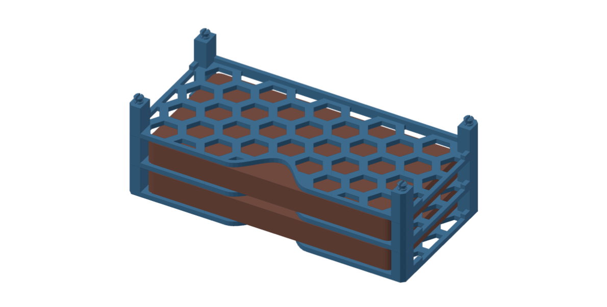

# 手机堆叠支架配置器

给 3D 打印手机支架选款、调尺寸、看装配效果，并导出可切片的 STL。每层放一部手机，四角用双爪卡扣叠接。可选长边取机、短边全收纳和短边外悬三种款式。

[下载项目 ZIP](https://github.com/CN-WenYu/phone-stack-configurator/archive/refs/heads/main.zip) · [下载默认模型](#默认模型) · [修改源码](#修改源码)



## 快速开始

1. 下载并解压项目 ZIP，用支持 **WebGL 2** 的现代浏览器打开 `index.html`。页面内置三维运行库和模型数据，可离线使用。
2. 选择款式和镂空样式。六边形蜂窝、菱形和三角形均支持 **35%–60%** 的镂空率设置，每档相差 5 个百分点。
3. 输入以毫米为单位的**单层外尺寸**，点击「应用尺寸」。外部高度包含顶部卡扣，页面会同时显示内部净尺寸或承托范围。四角卡扣、插孔和托板厚度在调尺寸时保持原尺寸。
4. 旋转模型检查取机口和充电开口，点击「导出当前单层 STL」，用 Bambu Studio 或其他切片软件打开。导出的 STL 按毫米建模，每多叠一层就多打印一份。

量手机时，把保护壳和镜头凸起计入外尺寸，用实测值对照页面显示的净尺寸。页面内的手机示例为 **176 × 87 × 16 mm**。

## 默认模型

以下文件使用六边形蜂窝和 50% 镂空率。表中尺寸为**长 × 宽 × 高**，单位为毫米。

| 款式 | 单层外尺寸 | 内部净尺寸或承托范围 | 下载 |
| --- | --- | --- | --- |
| 横向取机（长边开口） | 198 × 94 × 27.05 | 180 × 90 × 19 | [3MF](models/phone-stack-long-edge.3mf) · [STL](models/phone-stack-long-edge.stl) |
| 侧向全收纳（短边开口） | 184 × 108 × 27.05 | 180 × 90 × 19 | [3MF](models/phone-stack-short-edge.3mf) · [STL](models/phone-stack-short-edge.stl) |
| 侧向外悬（短边开口） | 121.333 × 108 × 27.05 | 117.333 × 90 × 19（承托范围） | [3MF](models/phone-stack-short-overhang.3mf) · [STL](models/phone-stack-short-overhang.stl) |

## 切片与试装

- 3MF 内含模型几何。导入后选择实际的打印机、喷嘴和材料。三种默认款已用 Bambu Studio 的 P2S、0.4 mm 喷嘴、0.20 mm 层高和 PLA 配置验证无支撑切片。
- 改过尺寸后，先查看自己的切片预览。计划打印多层时，可先试打两层，检查卡扣松紧和取机空间，再按所需层数打印。侧向外悬款还需用自己的手机确认承托和取放稳定性。

## 修改源码

| 文件 | 用途 |
| --- | --- |
| [src/preview.html](src/preview.html) | 页面结构、样式和预设网格数据 |
| [src/preview.js](src/preview.js) | 三维交互、尺寸调整和 STL 导出 |
| [src/phone_stack.py](src/phone_stack.py) · [src/stack_locks.py](src/stack_locks.py) | 支架、卡扣、默认模型和预设网格的生成逻辑 |
| [build_preview.py](build_preview.py) | 构建可直接离线打开的 `index.html` |

调整页面或交互后，在项目根目录运行 `python build_preview.py`。重新生成模型时，使用 Python 3.10 或更新版本并运行：

```sh
python -m pip install -r requirements.txt
python src/phone_stack.py --preview src/preview.html
python build_preview.py
```

在 macOS 或 Linux 上也可用 `python3`，Windows 上可用 `py`。模型生成命令会更新 `models/` 中的 3MF、STL 以及页面的预设网格。运行 `python src/phone_stack.py --help` 可查看导出参数。

## 许可证

项目采用 MIT 许可证。内置的 Three.js 0.180.0 和同版本 OrbitControls 保留其 MIT 许可。[项目许可证](LICENSE) · [Three.js 许可证](vendor/three-LICENSE.txt)
